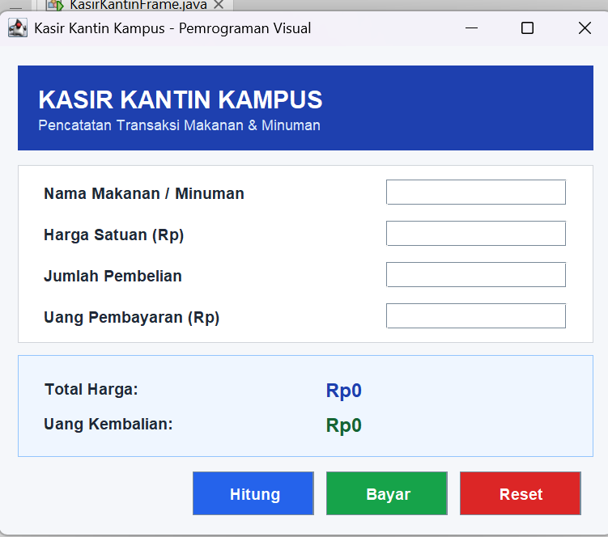
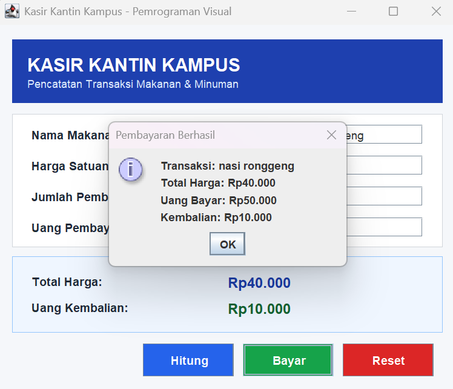

# Aplikasi Kasir Kantin Kampus

## Identitas Mahasiswa
- Nama: Daffa Shafiyyul 
- NIM: C2483207003
- Kelas: PTI 5
- Mata Kuliah: Pemrograman Visual
- Dosen Pengampu: Taofik Muhammad, M.Kom

## Deskripsi Aplikasi
Aplikasi Kasir Kantin Kampus adalah aplikasi desktop sederhana yang dibuat menggunakan Java Swing dan Apache NetBeans IDE. Aplikasi ini membantu proses transaksi makanan dan minuman, mulai dari menghitung total harga, menerima pembayaran, hingga menghitung uang kembalian.

## Fitur Aplikasi
1. Input nama makanan atau minuman.
2. Input harga satuan.
3. Input jumlah pembelian.
4. Menghitung total harga.
5. Menghitung uang kembalian.
6. Validasi input.
7. Tombol Hitung, Bayar, Reset, dan Keluar.

## Komponen Java Swing
- JFrame
- JPanel
- JLabel
- JTextField
- JButton
- JOptionPane

## Teknologi yang Digunakan
- Bahasa Pemrograman: Java
- GUI: Java Swing
- IDE: Apache NetBeans
- Database: Tidak menggunakan database.

## Screenshot Aplikasi

### 1. Tampilan Utama

### 2. Hasil Perhitungan Total

### 3. Hasil Pembayaran dan Kembalian

## Cara Menjalankan Aplikasi
1. Buka Apache NetBeans IDE.
2. Pilih File → Open Project.
3. Pilih folder KasirKantinKampus.
4. Buka package kasirkantinkampus.
5. Jalankan FormKasir.java.

## Hasil Pengujian
1. Nasi Goreng: Total Rp30.000, kembalian Rp20.000.
2. Mie Ayam: Total Rp36.000, kembalian Rp4.000.
3. Es Teh: Total Rp20.000, pembayaran kurang Rp10.000.

## Penutup
Aplikasi ini dibuat untuk memenuhi tugas Ujian Tengah Semester mata kuliah Pemrograman Visual.